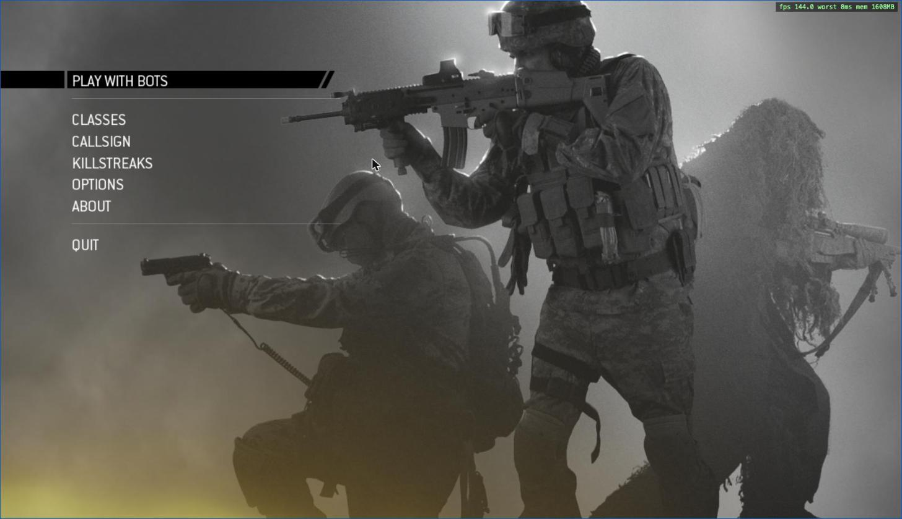
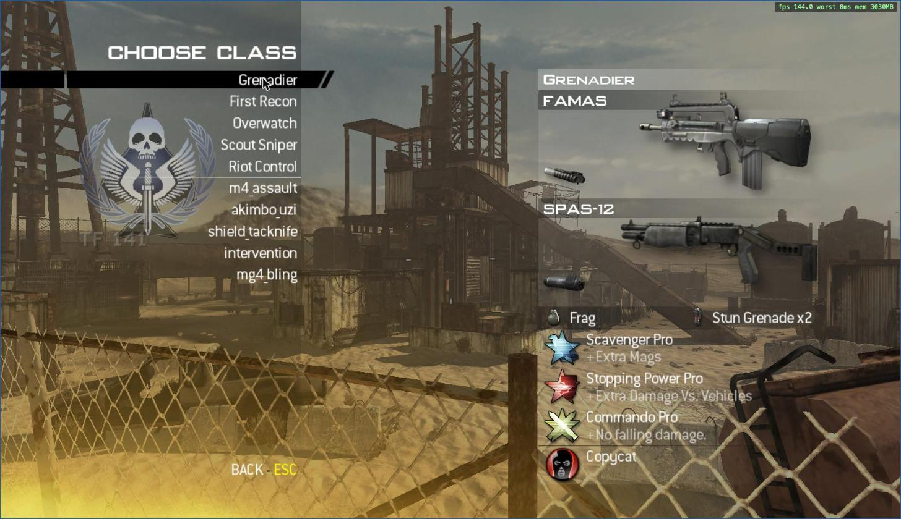
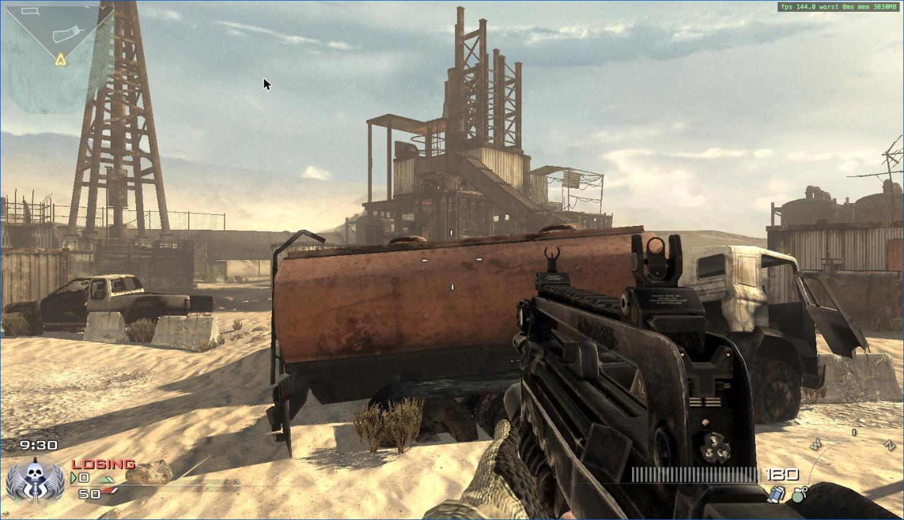

# iw4l-browser

**Modern Warfare 2 (2009) in your browser.** An unofficial, experimental WebAssembly + WebGPU
port of [IW4L](https://github.com/vladtrc/iw4L), the open-source Rust/Bevy runtime for MW2. It
runs offline against bots in Chrome, using game files **you already own**. Nothing is uploaded
and no game assets are included: files are read locally, from a small dev server on your
machine or from a folder you pick in the browser.

<p align="center">
  
  
  
</p>

## Quick start

You need Chrome with WebGPU, Rust with the `wasm32-unknown-unknown` target, Node.js, and your
own MW2 Multiplayer install (Steam PC).

```bash
rustup target add wasm32-unknown-unknown
cargo install wasm-bindgen-cli --version 0.2.129
scripts/build-web.sh
node crates/web/www/serve.mjs "/path/to/your/MW2 folder" 8137
```

Open <http://localhost:8137/index.html>, or `index.html?map=mp_rust` to skip the menu. Keep
the tab in the foreground. Full instructions, URL options, how it works and known gaps are in
[crates/web/README.md](crates/web/README.md).

Status: experimental. Menus, classes, maps, bots, HUD, shadows, audio and gamepad work.
There is no online play, and the biggest maps run close to the 4 GiB wasm32 memory limit.

## This fork

This is a fork of [vladtrc/iw4L](https://github.com/vladtrc/iw4L) and is not affiliated with
the upstream project. The browser layer lives in `crates/web` and `crates/web_window`, with
smaller wasm-specific changes elsewhere. Everything else, including the engine, asset readers
and gameplay code, is upstream's work and is used under its Apache-2.0 licence; see
[LICENSE](LICENSE) and [NOTICE](NOTICE). Unofficial fan project, not affiliated with
Activision or Infinity Ward. Call of Duty and Modern Warfare are trademarks of their owners.

---

## About IW4L (upstream)

IW4L is an open-source runtime for Call of Duty: Modern Warfare 2 (2009), written in
Rust with [Bevy](https://bevy.org/). Point it at a copy of MW2 you already own and it
loads that installation's maps, models, textures and weapons into its own engine. You
can try implemented movement and combat on multiplayer maps, then inspect or change how
those systems work.

<p align="center">
  
  
</p>

## What you can try

Explore maps, fight bots, and record and replay demos. Gameplay remains incomplete;
expect missing behavior, bugs and desyncs. The asset readers also cover MW3 and Black
Ops.

APIs, configuration, caches and the wire protocol change between commits;
multiplayer peers must run the same build.

## Desktop (Windows): prebuilt release

Upstream's release, not part of this fork.

1. Download `iw4l-windows.zip` from upstream's [Releases](https://github.com/vladtrc/iw4L/releases) and extract it into an
   empty writable folder. The archive password is `t.me/contextrot`.
2. Launch `iw4l.exe`. It finds MW2 in your Steam libraries and creates a
   `Modern Warfare 2.lnk` shortcut next to itself. For an install outside Steam, create
   that shortcut to your MW2 folder yourself.

For online play, put the `.iw4l-server` file you received from a server operator next
to `iw4l.exe`. With it the game finds that master and updates itself on launch. Details:
[Windows guide](docs/WINDOWS.md).

## Desktop: build and run

Install Rust through rustup and GNU Make. [Build dependencies](docs/BUILD.md) cover
Linux's C/C++ toolchain and system libraries, and macOS's Xcode command line tools.
[Windows instructions](docs/WINDOWS.md) cover building and arranging a portable folder.

You need your own installed MW2 Multiplayer data. IW4L
distributes no game assets and reads installations without patching or replacing their
files. Caches, demos and logs go under `iw4l-artifacts/`; Linux settings use a separate
configuration directory described in the [run guide](docs/RUN.md).

From the repository root:

```bash
cp .env.example .env
# Edit .env: set IW4L_GAMES to the folder containing your game installations.
make map mp_boneyard CMDS='wait world; spawn 0; force_match_start; bot add 3'
```

This builds the optimized `play` profile and starts a local match with three bots.
`force_match_start` skips the warmup that otherwise freezes movement.

## Inside the engine

| Area | Implementation |
|---|---|
| Assets | Native FastFile readers convert game data into a shared intermediate representation. |
| Shaders | Retail Direct3D 9 Shader Model 3 bytecode is translated to WGSL. |
| Rendering | World geometry, models and effects feed one sorted draw-surface list. |
| Simulation | Server authority, client prediction and replay share one simulation step over explicit Bevy ECS state. |
| Networking | Custom UDP traffic; a QUIC master provides browsing and relaying. The host simulates the match. |

## Where to go next

- [Run guide](docs/RUN.md): console commands, classes and demo playback; [master setup](docs/MASTER.md) for playtests.
- [Rendering](docs/RENDER.md) and [simulation](docs/SIM-STEP.md): inspect the engine's implementation.
- [Map loading](docs/MAP-LOAD.md), [GSC runtime](docs/GSC-RUNTIME.md) and [bot AI](docs/BOTS.md): starting points for experiments and modifications.
- [Documentation index](docs/INDEX.md), [contributing](CONTRIBUTING.md) and [security reports](SECURITY.md).

This whole project is written by an LLM.

## Acknowledgements and license

Thank you to all contributors for code, bug reports, testing and feedback.
Special thanks to **ju1cedr1nker** and **silvernote03** for QA testing weapons,
maps, attachments and other gameplay features.

[OpenAssetTools](https://github.com/Laupetin/OpenAssetTools) and its [iw4x-x64
fork](https://github.com/iw4x-x64/oat) informed asset layouts;
[IW4x](https://github.com/iw4x/iw4x-client) informed asset and protocol behavior;
[KisakCOD](https://github.com/SwagSoftware/KisakCOD) informed engine structure.
[Ghidra](https://github.com/NationalSecurityAgency/ghidra) was used to inspect the
original binaries.

Movement implementation history and source boundaries are recorded in
[its provenance note](docs/provenance/movement-iw4.md).

IW4L's source is licensed under [Apache 2.0](LICENSE). Preserve required attribution and
bundled font license texts when redistributing; see [NOTICE](NOTICE). Original game
assets and trademarks belong to their owners. IW4L is unaffiliated with them.
